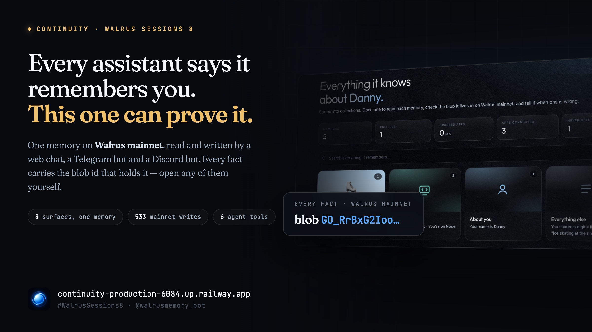
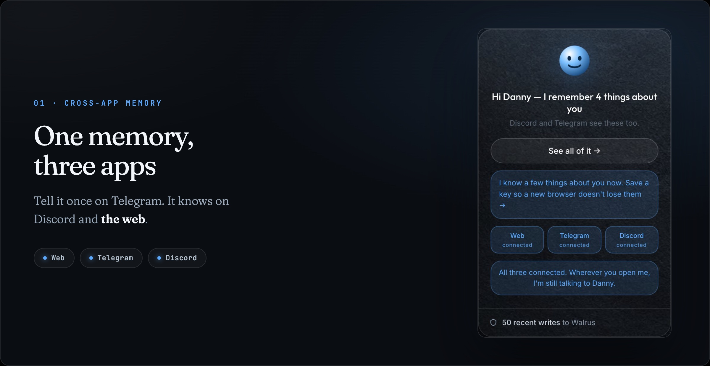
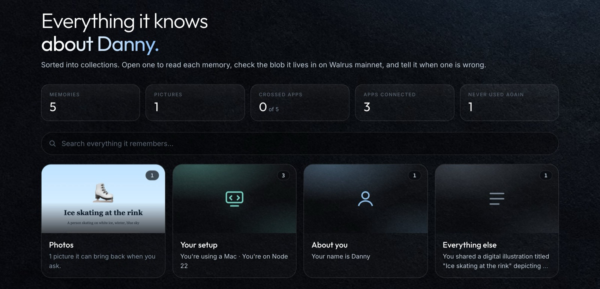

# The day my chatbot *quietly replaced* its user

**Why I built a general assistant instead of the support bot everyone suggested, what it taught me about what Walrus is actually for, and the day the memory layer handed me a convincing replacement for one of my users.**

*Walrus Sessions 8 · Chatbots that remember* · Danny · Continuity · Kimi K2.5 · never GPT or Claude · 11 min



---

Every time I described this project, somebody suggested I narrow it. Make it a support bot. Make it a shopping assistant. Pick a vertical.

I didn't, and the first reason is sitting in the code: **Support desk is one of four modes**, alongside Tutor, Coding partner and Planner. A customer service bot is not a product here, it is a setting.

> **A niche bot is the easier build and the weaker proof.**

Give a support bot a memory and you have given it a ticket history: a table keyed on a customer id, a thing that has existed since the 1990s. Nothing about it needs decentralised storage or an append-only log or a blob id you can audit. You could fake it convincingly in an afternoon with Postgres and nobody could tell from outside. Same with a shopping assistant remembering your size. These are the demos that look like memory and are really just rows.

Memory gets interesting when it holds things that stay true across contexts. That I use pnpm and never npm. That the Result step of STAR is where I fall apart under interview pressure. That I got question four wrong on Tuesday. Those facts belong to no vertical, and they are worth something to the person they describe, which is the test I kept returning to: *would you want to own this record?* Nobody wants to own a shopping bot's model of them. People do want to own the record of how they work and what they are trying to learn.

That question also decides whether any of this belongs on Walrus. Durable, auditable, user-facing storage is overkill for a ticket queue and exactly right for a record someone should be able to inspect, carry between apps, and verify was not quietly rewritten.

## What it actually does for me

**Continuity** is one assistant reachable from three places: a web chat, Telegram, and Discord. Not three bots sharing a database. One memory, on Walrus mainnet, that all three read and write.

It reads documents I paste at it (PDFs, notes, logs) and describes photos I send, so both become things I can search for by describing them months later rather than by remembering a filename. In Tutor mode I can hand it lecture notes and it writes questions from the document's own words, then **remembers which ones I got wrong**, so the thing I fumbled on Telegram on Tuesday comes back on Discord on Friday. Any model can quiz you from a document. Remembering where you got stuck is the part that needed Walrus.

The modes change how it answers without changing what it knows. Pick Tutor on Telegram and you have picked it on Discord. On Telegram I can forward it any message and it keeps it with who said it, or type `@walrusmemory_bot` in any chat to pull up what it knows without leaving the conversation. There is a dashboard listing everything it has stored about me, each fact carrying the blob that holds it, and a button to tell it that something is wrong.

The demo is deliberately boring, which is the point. Say something in Telegram, ask about it in Discord, ask again on the web. A real recorded session, with the actual latencies:


*three apps · three accounts · one person*

Breadth is also what made the hard bug findable, which I did not expect. Three surfaces reading one memory meant identity had to be exactly right, and that is where everything went wrong.

https://youtu.be/tU6CjMPRauw

*Seventy-six seconds, no cuts inside a shot. A photo sent on Telegram, asked for on Discord, and the blob holding the memory opened on Walruscan. Then a PDF pasted into the web chat, read, filed, and its bytes shown on Walrus. Also [on YouTube](https://youtu.be/tU6CjMPRauw), and the file itself is [on Walrus](https://walruscan.com/testnet/blob/BZChq60laZX2o8OCtlrCCIRS1wWmCOLCycNGtUk7hlA), because an article about storing files on Walrus ought to store its own.*

**533** writes on Walrus mainnet · **3** surfaces, one memory · **5** bugs filed on MemWal · **741** checks guarding all of it

## The day it replaced a user

Somewhere around the third day of building, a user of my bot stopped existing.

Not dramatically. Nothing errored, nothing went red, no alert fired. A person had four memories stored against their account, opened the web chat, and was greeted like a stranger.

Behind that greeting, the bot had read their identity record, got back an empty result, concluded it had never met them, and minted a brand new person id. Storage is append-only, so newest wins. From that moment every read returned the new, empty person. The four memories were still on Walrus. They were just unreachable, permanently, and nobody would ever have known why.

```
ws8::id::web::web-proof-2 →
  d083f353-…   minted by a false empty — no memories
  fcc93702-…   the real one — 4 memories, orphaned
```

*two identities for one account, newest wins*

I was building for a hackathon whose entire premise is *chatbots that remember*. The memory layer had just forgotten someone, silently, and handed me a convincing replacement. A support bot would have survived this: lose a ticket history and somebody re-types their order number. Lose the thing that knows who you are across three apps and there is nothing to re-type.



*Not a claim that it works across apps. The three surfaces reporting themselves connected, with the write count underneath.*

## What MemWal taught me about Walrus

Walrus Memory stores text. Every write method takes a string, and for two weeks that was all I needed, because facts about a person are sentences.

Then I added photos. The bytes of a photograph can never be a memory. What *can* be a memory is a description, and the description turns out to be the valuable half, because it is the part recall can search. "Me ice skating" matches a sentence about a person on ice. It does not match pixels.

So an attachment became two halves: the description to Walrus Memory, the bytes to a volume on the server. That worked, and a redeploy showed me what was wrong with it. A description of a lease is durable; it's a memory. The lease itself sat on a disk that a deploy wipes.

> **The memory outlived the file it described. That is exactly backwards.**

So I stopped treating Walrus as the thing underneath MemWal and started using it directly. The bytes go to Walrus now, and the blob id is written **into the memory**, next to the filename:

```
A file the user shared on telegram, 4 Oct 2026 (lease.pdf):
A residential tenancy agreement for 14 Oak Road, twelve
months from 1 November…
[file:d86524ec-….pdf][walrus:nMxaSHx54ESfmruT6HCCOnVl…]
```

*one sentence, two pointers: the local copy and the one that outlives it*

That single line is the whole design. The pointer to a file comes back from the same read that finds the file, so there is no second database to keep in sync and no index sitting on the very disk whose loss this is meant to survive. The volume became a cache.

Mine is a narrow slice of what people build on this storage. [OnlyFins](https://docs.sui.io/sui-stack/walrus/only-fins), Mysten's own reference app, puts images on Walrus and gates them with Seal, each post a Sui object holding a blob id. **Tusky** is consumer file storage on it. Walrus Sites serves whole front-ends from it. All of them treat a blob as the product. Mine treats a blob as the thing a *sentence* points at, which is the only reason a chatbot can hand you back a file you described rather than named.

## Everything on Walrus is public, and I found out late

Three days before the deadline I read the storage documentation properly instead of skimming for the endpoint I needed. There is a caution box near the top.

> "Both blob contents and their metadata are public. Blob IDs, blob attributes, and the onchain blob registration are all discoverable by anyone, so an attacker can enumerate and read everything you store. **Never store secrets or private data unencrypted.**"

> 
> *docs.sui.io · Data Storage Using Walrus*

I had been doing exactly that for two days, and it did not even require enumeration, because my own memory page prints the blob id next to the file.

The worst single thing I put up there was an 87-page pharmacology deck somebody had uploaded to be quizzed on. Not an anonymous PDF. The lecturer's name, their title and their department are on the front page. I cannot unwrite it; append-only means what it says. What I can do is stop pointing at it, so the blob id that used to sit in this article as proof is gone from it. The memories themselves were never at risk, because the relayer SEAL-encrypts those before they leave. It was the attachment layer I built on top that went up readable.

Bytes are sealed now before they leave and opened after they come back: AES-256-GCM, a random nonce per blob so identical files do not produce identical ciphertext, an auth tag so tampering fails to open rather than decoding to nonsense. The blob stays public and enumerable, because that is what Walrus is. What an enumerator finds is ciphertext.

Be precise about what that is *not*. The key is the server's, so it protects you from a stranger reading Walrus and not from whoever runs this server. The right answer is [Seal](https://seal.mystenlabs.com/), threshold encryption with the access policy on Sui, which is what OnlyFins uses to gate images behind an on-chain token. I know where it plugs in. I did not have time to build it, so I am not claiming it.

## Before and after

This section used to be a table of numbers I had typed, which is the weakest kind of claim: you had no way to tell a measurement from a flattering memory, and after a week neither did I. So every row below is produced by a script that runs against the live deployment, and every row carries the command that produced it. Run them. Two of them write new blobs to Walrus each time, so your output will not be byte-identical to mine, which is rather the point.

**The same sentence, to anyone holding the blob id**

- **was:** Readable. Straight off the public aggregator, no key, no auth.

- **now:** 179 bytes: an 8-byte header, a 12-byte nonce, a 16-byte auth tag, and 143 bytes that are not the sentence.

*check it:*

Two blobs holding the same sentence, written seconds apart in one run. The first went up the way the old code wrote it. The second went through the app.

```
$ curl -s https://aggregator.walrus-testnet.walrus.space/v1/blobs/RfDLZ5dWeoJ3M9tLbqmhJcRjZGPmv4PSFYDOaqmtoCA
Continuity proof-of-encryption, written 2026-10-06T14:25:…
If you are reading this sentence off the Walrus aggregator, the seal failed.

$ curl -s https://aggregator.walrus-testnet.walrus.space/v1/blobs/Z5PMU1ExNXSeE6TnJsX4BBCzj9TxeoOsc9KZlSEaLlE | xxd -l 24
00000000: 5741 4c58 3100 0000 b731 8a68 2fad de7b  WALX1....1.h/..{
00000010: de7d 2a93 e455 1fd2                      .}*..U..
```

**The same file, to the person it belongs to**

- **was:** Gone after a redeploy. "File no longer on this server."

- **now:** 143 bytes back, byte-identical to what went in, read out of Walrus and opened.

*check it:*

The same blob id as above, through the app instead of the aggregator. Ciphertext to a stranger, the original file to its owner.

```
$ curl -s continuity-production-6084.up.railway.app/blob/Z5PMU1ExN…
Continuity proof-of-encryption, written 2026-10-06T14:25:…
```

**The second message anyone ever sends**

- **was:** "I can't read my memory back right now — the storage service is blank this turn."

- **now:** "You're Priya, you've got a backend interview coming up next Tuesday, the 13th. And the Result bit of STAR is where you tend to lose your footing."

*check it:*

A fresh person id, two messages, no pause between them. The write has not landed yet when the second one arrives. That is the whole difficulty.

```
$ curl -s continuity…/api/chat -H 'content-type: application/json' \
    -d '{"userId":"you-pick-one","text":"Hi, I am Priya. I have a backend
         interview next Tuesday and I fumble the Result part of STAR."}'
$ curl -s continuity…/api/chat -H 'content-type: application/json' \
    -d '{"userId":"you-pick-one","text":"what do you know about me?"}'
```

**The memory dashboard, twelve reads at once**

- **was:** 503, blank page.

- **now:** 200 twelve times over, in 1.9 seconds.

*check it:*

```
$ for i in $(seq 12); do curl -so /dev/null -w '%{http_code} ' \
    "continuity…/api/memory?userId=you-pick-one" & done; wait
200 200 200 200 200 200 200 200 200 200 200 200
```

**Recall latency, and the number I am not going to dress up**

- **was:** Three round trips to confirm a new account was new, before a first-time visitor saw a word.

- **now:** One. Recall p50 1.4s, p95 2.9s. First replies still land anywhere from 2.4s to 13.7s, because that is the model's time, not the memory's.

*check it:*

Live counters, not a screenshot. The ledger is the last 50 writes, each one a blob id you can open on Walruscan.

```
$ curl -s continuity…/api/stats | jq .metrics.recall
$ curl -s continuity…/api/ledger | jq '.writes[0]'
```

The third receipt is the one that mattered most. A write takes seconds and recall only sees what has landed, so the most natural second message anybody sends arrives inside that gap and reads back as amnesia. What is queued for a person is not a guess, though: they said it out loud a moment ago. Consulting the outbox when the search comes back empty closed it.

Two decisions did the rest. Identity lives at a derived key, `ws8::id::{surface}::{account}`, never at whatever a vector search thinks is close enough, because relevance ranking will happily hand you a superseded record. And "current value" means newest, chosen server-side via `sort: "recent"`; sorting what came back would mean a superseding record outside the cosine window could never be recovered at all.

> **“Trust me, it's on Walrus” is a claim. A blob id per sentence is evidence.**



*Everything it knows, sorted, each fact carrying the blob that holds it. You can open any of them on Walruscan without asking me anything.*

## What broke, honestly

I filed five bugs on MystenLabs/MemWal while building this. They are worth describing because they share a shape: **failure wearing the costume of success.**

### Recall returns empty, at random [#1036](https://github.com/MystenLabs/MemWal/issues/1036)

Fourteen identical calls against a namespace holding thirteen memories, 800ms apart:

```
5  5  5  5  0  0  5  5  0  0  0  0  5  5
```

Empty six times out of fourteen. No error, no flag. An empty recall is also the correct answer for a genuinely new user, so nothing downstream can tell the difference: your chatbot forgets people roughly 40% of the time and reports perfect health. That is what ate my user's history.

### A relevance filter erases the evidence [#1066](https://github.com/MystenLabs/MemWal/issues/1066)

Set `maxDistance` tight enough to filter everything and you get `{results: [], total: 0}`, byte-identical to an empty namespace. Both SDKs overwrite the server's match count with the post-filter count, so the library manufactures the exact ambiguity above, deterministically. That threshold was *added* to keep filler out of prompts, and nobody noticed it destroys the signal separating "nothing relevant" from "nothing stored."

### An idempotency key is a one-way door [#1057](https://github.com/MystenLabs/MemWal/issues/1057)

Reuse one with different content and you get a 409, forever. Replaying the *original* text still works and returns the original blob, so the key behaves perfectly until your payload changes by one character, and then it can never carry a new write again. I locked out a live Telegram account this way. The only symptom was silence.

### Writes that succeed report failure [#742](https://github.com/MystenLabs/MemWal/issues/742)

`rememberAndWait` polls for 60 seconds and throws a timeout; on mainnet jobs routinely take longer and then complete normally. Treat the throw as failure and retry, and you own two permanent copies of the same memory, both paid for. I measured a retried fact returning as two recall hits at distance 0.450 and 0.458, with nothing marking either a duplicate.

Two more: `maxTokens` is not validated ([#1068](https://github.com/MystenLabs/MemWal/issues/1068)), so a negative budget silently discards every result and still reports `truncated: true`; and the TypeScript SDK has no `ask()` binding though `/api/ask` is advertised in `/health` and works from Python ([#1067](https://github.com/MystenLabs/MemWal/issues/1067)). Seeding a knowledge base through bulk writes, 190 statements went in and 113 landed. Nothing threw.

None of this is a reason to avoid Walrus Memory. Server-side fact extraction inside a TEE is the right shape, and it saved me both model tokens and shipping raw conversations to a third party. `sort: "recent"` is exactly the primitive append-only storage needs. But a memory product's failure modes need to be loud, and several of these are mute.

## Putting this memory in your own app

Three surfaces share one memory because I wrote three adapters that all call the same function. That works, and it stops working the moment somebody else wants a fourth. Nobody building on Walrus should have to wait for me.

So the memory is an MCP server now. Point any client at it and it gets six tools: `recall`, `remember`, `list_files`, `find_file`, `get_file`, `list_photos`. Two transports, stdio for a client that spawns a process and HTTP for one that posts to a URL, both dispatching through the same function so they cannot drift.

```
$ curl -s continuity-production-6084.up.railway.app/mcp \
    -d '{"jsonrpc":"2.0","id":1,"method":"tools/call","params":
         {"name":"remember","arguments":{"user":"alice",
          "fact":"They prefer Rust over Go."}}}'
Written. walrus: XPp81H4XPE-CdB0N4GI-DIOVR7F2jnWGzcc4i-XBrUY

$ … {"name":"recall","arguments":{"user":"alice",
      "query":"what language do they like"}}
• They prefer Rust over Go.
  walrus: XPp81H4XPE-CdB0N4GI-DIOVR7F2jnWGzcc4i-XBrUY
```

*a real round trip against the live deployment; [that blob id opens on mainnet](https://walruscan.com/mainnet/blob/XPp81H4XPE-CdB0N4GI-DIOVR7F2jnWGzcc4i-XBrUY)*

Both of those are live. [GET the same URL](https://continuity-production-6084.up.railway.app/mcp) and it describes itself rather than returning a protocol error, because the first thing anybody does with an endpoint is open it in a browser.

The identity model already had the bones for this. A person is an id and an account is a `(surface, account)` pair, so another app is simply a new surface; `mcp` joins web, telegram and discord, and the existing link flow merges them by union rather than migration. The write returns a blob id rather than the word "ok", because the receipt rule should apply to other people's agents too.

Two things are deliberately missing, and they are the difference between this and the thing you are probably imagining.

**Continuity cannot yet use *your* tools.** This is the server half: your agent calls into my memory. The reverse needs a tool-calling loop the agent does not have: Continuity connecting to a Walrus app's MCP server, discovering its tools, operating it for you. It has no such loop because `llm.mjs` sends a prompt and gets prose back. That is the interesting half and it is not built. I would rather write that sentence than let the word "MCP" imply it.

**And the ceiling is not the protocol, it is the rate limit.** Roughly 1000 weighted requests an hour and 60 a minute, shared across every surface, with a chat turn costing about eight. "Any Walrus app can plug in" is true of the interface and false of the budget. Scoped consent is the other gap: a tap-a-number sign-in proves you are holding two devices, and it cannot express *this app may read my files but not my facts*.

## If you are about to build on this

- **Never use a semantic search as an existence check.** "Have I seen this user?" needs an exact lookup. A false negative there is unrecoverable rather than merely wrong, and it is the whole first half of this article.

- **Retry on empty, but only for keys you have already seen hold data.** Four attempts over about three seconds took my empty rate from 6-in-14 to 0-in-16. Retrying genuinely empty keys is wasted load and part of what got me rate limited.

- **Treat a write timeout as unknown, not failed.** Keep the job id, settle it later with `getRememberStatus`, and never re-send the text. Retrying blind is how you get permanent duplicates on storage that cannot delete.

- **Watch the budget.** Roughly 1000 weighted requests an hour and 60 a minute, shared across every surface. One chat turn spends about eight.

## See for yourself

Continuity is live, and the bot is [@walrusmemory_bot](https://t.me/walrusmemory_bot) on Telegram. The model is Kimi K2.5 through OpenRouter, deliberately not GPT or Claude. Here is a memory written while I was measuring the receipts above, on Walrus mainnet: [`GO_RrBxG2IooqRbvauy9…`](https://walruscan.com/mainnet/blob/GO_RrBxG2IooqRbvauy9oIKLV976t87dalOGc4ENAwE).

One honest split in that pair of networks. Memories go to mainnet because the relayer pays for them. Raw blobs have no sponsor, since mainnet writes cost WAL and SUI from a funded wallet and the public mainnet publishers are not open, so file bytes go to testnet: open, free, genuinely erasure-coded. The network travels with every blob id, because "the files are on mainnet" would be a nicer sentence and a false one.

Two more things I should be doing and am not: `WalrusFile` batches up to around 660 small blobs into one through Quilt, which is exactly a chatbot's attachment workload, and I upload them one at a time; and `send-object-to` would transfer the blob object to my own Sui address instead of leaving it with the publisher.

You can also tell it to forget something, and it says exactly what that does:

> I'll stop using that. The blob itself stays on Walrus — append-only storage means I can't unwrite it, and I'd rather say so.

It would have been easy to label that button "delete" and let you assume the rest. On append-only storage that is a lie, and a memory product that lies about forgetting is worse than one that cannot forget.

Both of the worst things in this article were found the same way: by writing down what actually happened and then reading it. The identity bug was findable because the bot keeps a ledger of every blob it writes. The lecture deck was findable because the documentation says so plainly and I eventually sat down and read it.

> **Memory you can't audit isn't memory. It's a confident voice telling you it remembers.**

[Open the chat →](https://continuity-production-6084.up.railway.app)
